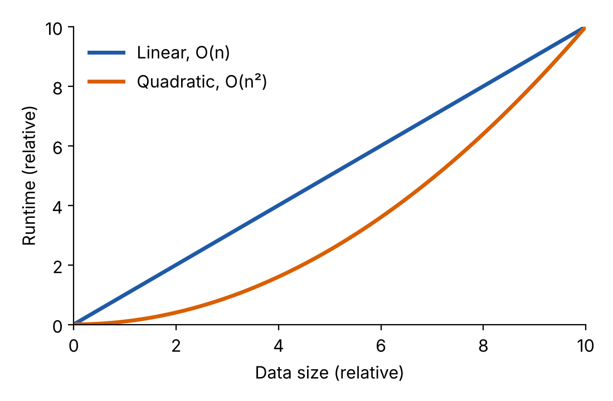
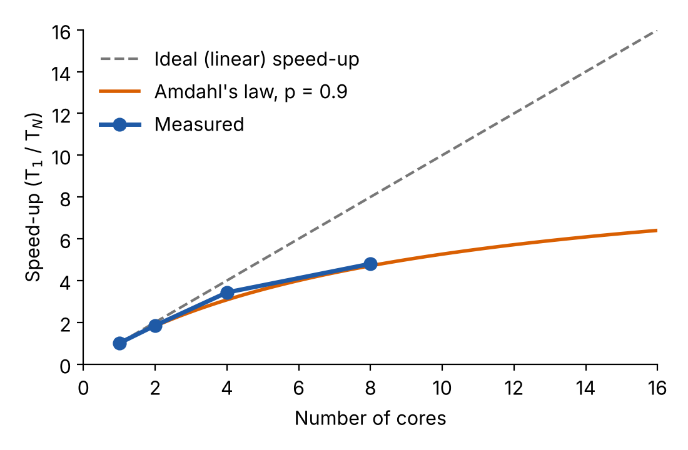

Before asking for time on an HPC system, you need to know *how much* you will need. Ask for too little and your jobs will be killed half way through; ask for too much and you will wait longer in the queue and waste a shared resource. This second part of the course shows you how to estimate the resources your project needs, starting from small, representative tests.

#### Intended learning outcomes

By the end of this part, you will:

- Understand the key HPC resource concepts: wall-clock time, CPU time and core-hours
- Know how to run representative benchmarks of your code
- Be able to use simple command-line tools to measure time and memory
- Be able to convert benchmark timings into a realistic resource request

#### Prerequisites

- Basic familiarity with the command line and the job scheduler (see the [previous part](040-slurm.qmd))
- A computational task you want to benchmark

## Key definitions

HPC allocations are usually measured in **core-hours**:

$$
\text{core-hours} \approx \text{wall-clock time (hours)} \times \text{number of CPU cores}
$$

| Term | Meaning |
|------|---------|
| **Wall-clock time** | Elapsed time, as measured by a stopwatch |
| **CPU time** | Time the processors were actively working for you (excludes waiting for I/O) |
| **Task** | One independent run of your code (one simulation, one dataset, ...) |
| **Job** | What you submit to the scheduler; it may contain many tasks |

::: {.callout-note}
### Example

A program that runs for 2 hours using 8 cores uses 2 × 8 = **16 core-hours**.
:::

## CPU time versus wall time

The relationship between CPU time and wall-clock time tells you a lot about how your program behaves:

- **Single core:** CPU time ≈ wall time
- **Multiple cores:** CPU time ≈ wall time × number of cores in use
- **I/O heavy** (lots of reading and writing files, waiting for the network): wall time > CPU time

The Linux tool `/usr/bin/time -v` reports all of these. An example of its output:

```
Elapsed (wall clock) time (h:mm:ss or m:ss): 0:02:15
User time (seconds): 120.45
System time (seconds): 12.33
Maximum resident set size (kbytes): 2048000
```

Here the wall-clock time is 2 min 15 s (135 s) and the CPU time is the user plus system time (132.8 s), so the program was busy almost all the time on a single core. The *maximum resident set size* is the peak memory used: about 2 GB.

::: {.callout-tip}
Understanding this relationship helps you optimise your resource requests: if the CPU time is much lower than the wall time multiplied by the cores you asked for, you are reserving cores that are sitting idle.
:::

## Why measure rather than guess?

::: {.columns}
::: {.column width="50%"}
### Common mistakes

- Ignoring that HPC cores may be faster (or slower!) than your laptop
- "My laptop takes 1 hour, so I need 100 hours for 100 runs": this ignores that the runs can be done at the same time
- Missing parallelisation opportunities
- Forgetting that there is some overhead in scheduling and starting jobs
:::

::: {.column width="50%"}
### Best practice

- Benchmark on the **target system**
- Use **representative data**
- **Measure** actual resource usage
- Account for **variability** between runs
:::
:::

## Scaling laws

### How does runtime grow with the amount of data?

The way the runtime grows when the problem gets bigger decides how you can extrapolate from a small test to the full problem.

{fig-alt="Plot comparing linear and quadratic growth of runtime with data size" width=60% fig-align="center"}

| Pattern | Behaviour | Typical example |
|---------|-----------|-----------------|
| **Linear**, O(n) | 2 × data → 2 × time | Processing each file or record independently. Safe to extrapolate |
| **Quadratic**, O(n²) | 2 × data → 4 × time | All-pairs comparisons, e.g. distance between every pair of points |

### Testing your scaling

Run your program with increasing fractions of your data and compare the times:

```bash
./my_program --data 2percent_sample.csv   # measure time
./my_program --data 4percent_sample.csv   # should take ~2x longer if linear
./my_program --data 8percent_sample.csv   # should take ~4x longer if linear
```

::: {.callout-warning}
If the 8% sample takes 10× longer than the 2% sample (instead of 4×), you do **not** have linear scaling, and a straight-line extrapolation will underestimate the time needed for the full dataset.
:::

## Parallel scaling

When your code can use several cores, the time does not usually shrink in proportion to the number of cores. There are two ways of looking at this:

- **Strong scaling:** keep the problem size fixed and add cores. How much faster does it get?
- **Weak scaling:** increase the problem size in proportion to the number of cores. Does the runtime stay the same?

For strong scaling we define the **speed-up** and the **parallel efficiency** on $N$ cores as

$$
S(N) = \frac{T(1)}{T(N)}, \qquad E(N) = \frac{S(N)}{N} = \frac{T(1)}{N \, T(N)}
$$

where $T(N)$ is the wall-clock time using $N$ cores.

### Amdahl's law

Every program has some part that cannot run in parallel (reading the input, setting things up, ...). If a fraction $p$ of the work can be parallelised, the best possible speed-up on $N$ cores is

$$
S(N) = \frac{1}{(1 - p) + p/N}
$$

So even if 90% of your code is parallel ($p = 0.9$), you can never go more than 10× faster, however many cores you use.

### Testing parallel scaling

```bash
#!/bin/bash
dataset="my_data.csv"

for cores in 1 2 4 8 16; do
    echo "Testing with $cores cores..."
    /usr/bin/time -f "cores=$cores wall=%E cpu=%U+%S" \
        my_parallel_program --input $dataset --threads $cores \
        2>> scaling_results.log
done
```

::: {.callout-note}
### Example results

| Cores | Wall time | Speed-up | Efficiency |
|------:|----------:|---------:|-----------:|
| 1 | 120 s | 1.0 | 100% |
| 2 | 65 s | 1.8 | 92% |
| 4 | 35 s | 3.4 | 86% |
| 8 | 25 s | 4.8 | 60% |

Going from 4 to 8 cores only saves 10 seconds but doubles the core-hours used: 35 s × 4 = 140 core-seconds, against 25 s × 8 = 200 core-seconds. Using more cores is not always better value for your allocation!
:::

{fig-alt="Plot of speed-up against number of cores: measured values fall below the ideal straight line and follow Amdahl's law" width=60% fig-align="center"}

[Benchmarking your code](070-benchmarking.qmd)
