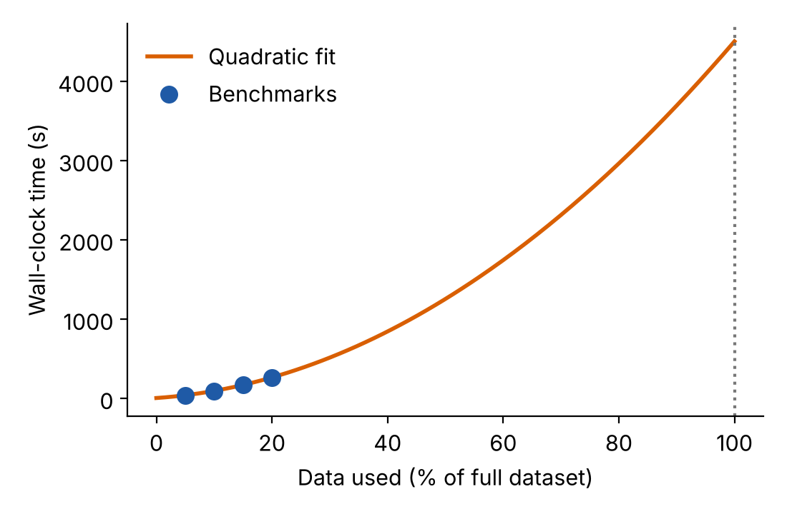

A **benchmark** is a small, controlled test of your code that you can use to predict what the full project will need. The goal is not to run everything, but to run *just enough* to learn how time and memory change as the problem grows.

## The benchmarking workflow

1. **Create representative test cases:** smaller versions of your real problem, using the same type of data and the same code path
2. **Test the scaling:** run with several sizes (e.g. 2%, 4% and 8% of the data) and see how the time grows
3. **Extrapolate carefully:** use the scaling you observed to predict the full problem, and add safety factors

::: {.callout-tip}
### Good habits

- Document your environment: software versions, loaded modules, and the machine you used
- Run **end-to-end** tests, including every step (reading the data, computing, writing results), because I/O can be a significant cost
- Benchmark on the same type of hardware you will use for the real runs
:::

## Essential measurement tools

### GNU time

The GNU `time` command runs your program and reports the resources it used. Note that you need to call it by its full path, `/usr/bin/time`, because most shells have a simpler built-in command with the same name.

```bash
# Basic timing with detailed output
/usr/bin/time -v my_program input.dat

# Custom format for logging
/usr/bin/time -f 'wall=%e user=%U sys=%S maxRSS=%M' my_program input.dat
```

| Output | Format code | Meaning |
|--------|-------------|---------|
| Elapsed (wall-clock) time | `%e` (seconds) or `%E` (h:mm:ss) | What a stopwatch would measure |
| User time | `%U` | CPU time spent in your code |
| System time | `%S` | CPU time spent in the operating system on your behalf (e.g. reading files) |
| Maximum resident set size | `%M` | **Peak memory** used, in kilobytes |

::: {.callout-note}
If `/usr/bin/time` is not available (for example on macOS), the shell built-in `time my_program` still gives you the elapsed, user and system times, but not the memory. In Python you can read the peak memory of a process with the standard `resource` module, as the exercise script of this course does.
:::

## Example: benchmark script

The script below runs a program with three different data sizes and saves the measurements to a log file, so they can be analysed later:

```bash
#!/bin/bash

for size in 2 4 8; do
    echo "Testing ${size}% data size..."
    /usr/bin/time -o benchmark_results.log -a \
        -f "size=${size}pct wall=%e user=%U sys=%S maxRSS_KB=%M" \
        my_simulation --input data_${size}pct.csv \
                      --output results_${size}pct.dat
done
```

The options `-o benchmark_results.log -a` tell `time` to **a**ppend its report to the log file, which keeps the measurements separate from anything your program prints.

### Allowing for sources of variability

Run times are never exactly the same twice: other users share the node or the file system, and your own code may use random numbers. Particularly when your tests are short, you should repeat each measurement a few times, for example by adding an extra nested loop:

```bash
for size in 2 4 8; do
    for run in 1 2 3; do
        /usr/bin/time -o benchmark_results.log -a \
            -f "size=${size}pct run=${run} wall=%e user=%U sys=%S maxRSS_KB=%M" \
            my_simulation --input data_${size}pct.csv \
                          --output results_${size}pct_run${run}.dat
    done
done
```

## Worked example: image processing

::: {.callout-note}
### Scenario

An image processing pipeline that

1. loads images from disk,
2. runs an object detection model, and
3. saves the results.

**Goal:** process 10,000 images and estimate the resources needed.
:::

### Step 1: create test datasets

Make smaller subsets of the full dataset by **random sampling**, so that they are representative of the whole:

```bash
# Create subsets of your full dataset
mkdir test_data_5pct test_data_10pct test_data_15pct

# Randomly sample (adjust the numbers for your case)
shuf -n 500  full_image_list.txt > test_data_5pct/image_list.txt
shuf -n 1000 full_image_list.txt > test_data_10pct/image_list.txt
shuf -n 1500 full_image_list.txt > test_data_15pct/image_list.txt
```

### Step 2: run the benchmarks

```bash
#!/bin/bash
module load languages/python/3.7.12

for size in 5 10 15; do
    echo "=== Testing ${size}% dataset ==="
    for run in 1 2 3; do
        echo "Run $run..."
        /usr/bin/time -o timing_results.log -a \
            -f "${size}pct run${run}: wall=%e user=%U sys=%S maxRSS_KB=%M" \
            python image_pipeline.py \
                --input test_data_${size}pct/ \
                --output results_${size}pct_run${run}/
    done
done
```

### Step 3: analyse the results

```bash
# Extract the timing data
grep "wall=" timing_results.log
```

```
5pct run1:  wall=135.21 user=121.45 sys=12.33 maxRSS_KB=2048000
5pct run2:  wall=138.04 user=123.12 sys=13.01 maxRSS_KB=2051000
5pct run3:  wall=134.77 user=120.88 sys=12.40 maxRSS_KB=2049000
10pct run1: wall=270.55 user=243.90 sys=24.78 maxRSS_KB=2052000
...
15pct run1: wall=405.38 user=366.22 sys=36.51 maxRSS_KB=2055000
...
```

Averaging the three runs of each size gives

| Data used | Wall time | Compared with 5% |
|----------:|----------:|-----------------:|
| 5% | ~135 s | 1× |
| 10% | ~270 s | 2× |
| 15% | ~405 s | 3× |

Doubling and tripling the data doubled and tripled the time, so the scaling is **linear**. The memory barely changes (about 2 GB in every case), so it does not depend on how many images we process. Extrapolating to the whole dataset (100%, i.e. 20 times the 5% test):

$$
135 \text{ s} \times 20 = 2700 \text{ s} = 45 \text{ minutes}
$$

and we should ask for about 2 GB of memory (plus a safety margin) for the job.

## If it is not linear

If the times do not grow in proportion to the data size, you can fit a curve through your measurements and use it to predict the full-size runtime. A polynomial of order 2 or 3 is generally a good option for capturing non-linear trends. You can do this in a spreadsheet (add a *trendline* to the chart and choose to display the equation) or in a few lines of Python:

```python
import numpy as np

percent = np.array([5, 10, 15, 20])
wall = np.array([40.0, 95.0, 170.0, 265.0])   # seconds

coeffs = np.polyfit(percent, wall, deg=2)     # quadratic trend
prediction = np.polyval(coeffs, 100)          # forecast for 100% of the data
print(f"Predicted wall time with all the data: {prediction / 60:.0f} minutes")
```

{fig-alt="Scatter plot of benchmark times for 5 to 20 percent of the data with a quadratic curve extrapolated to 100 percent" width=60% fig-align="center"}

::: {.callout-warning}
Extrapolating far beyond the range you measured is risky: here we predict at 100% from tests that stop at 20%, and small differences in the fit become large differences in the forecast. Use more test sizes (or larger ones) when your tests are a small fraction of the full problem, and always add a safety factor when converting the prediction to a resource request.
:::

[Benchmarking on HPC systems](080-benchmarking-on-hpc.qmd)
